# Neural ODEs for dynamical systems

[](https://github.com/crozol/02-neural-odes/actions/workflows/tests.yml)
[](https://opensource.org/licenses/MIT)
[](https://crozol.github.io/projects/02-neural-odes.html)
[](https://huggingface.co/spaces/crozol/neural-odes-hnn-demo)

**TL;DR** — Learning the right-hand side of pendulum and Lotka-Volterra dynamics from short noisy trajectories with a small MLP integrated by `torchdiffeq.odeint`. Relative extrapolation errors past the training window (mean ± std over 5 seeds) are **8.3 ± 2.4 %** (pendulum) and **0.96 ± 0.57 %** (Lotka-Volterra) for the unconstrained baseline; for Lotka-Volterra, a Hamiltonian Neural Network helps once the training data cover more than one orbit: trained on three trajectories and scored on five unseen ones, it reaches **2.4 % ± 0.4 %** relative error and **2.2 %** drift in the conserved `H`, against **5.0 %** and **8.6 %** for the same MLP in the same log-coordinates (5 seeds) — the control that removes the coordinate confounder of the naive comparison — with the HNN better on both metrics in 5 of 5 seeds (sign test `p = 1/32 ≈ 0.03`). Trained on a single trajectory, no model generalises to new orbits (17–18 %), and the HNN's lower `H` drift on that orbit comes mostly from the change to log-coordinates. Stack: PyTorch · torchdiffeq · NumPy.

A numerical experiment: take two textbook ODE systems whose ground-truth
vector field is known exactly, observe a short noisy trajectory of each, and
fit a small neural network that approximates the right-hand side
`dy/dt = f_θ(y, t)`. Then ask the natural question: when the learned ODE is
integrated forward *past* the time window it was trained on, does it still
behave like the real system?

The document walks through the measurement and the analysis in the order you
would actually perform them. The two systems chosen (a damped pendulum and a
Lotka-Volterra predator-prey model) are 2-dimensional so every result fits in
a clean phase-plane figure; they were also picked because they expose two
qualitatively different extrapolation tests — energy decay in the pendulum,
conserved orbit in Lotka-Volterra.

---

## Contents

1. [Objective](#1--objective)
2. [Equipment (software stack)](#2--equipment-software-stack)
3. [Background: what is a Neural ODE?](#3--background-what-is-a-neural-ode)
4. [The reference systems](#4--the-reference-systems)
   - [4.1 · Damped pendulum](#41--damped-pendulum)
   - [4.2 · Lotka-Volterra](#42--lotka-volterra)
5. [Procedure](#5--procedure)
   - [5.1 · Generating noisy trajectories](#51--generating-noisy-trajectories)
   - [5.2 · The parametrised vector field](#52--the-parametrised-vector-field)
   - [5.3 · Loss and gradients through the solver](#53--loss-and-gradients-through-the-solver)
   - [5.4 · The adjoint method](#54--the-adjoint-method)
   - [5.5 · A curriculum on the integration window](#55--a-curriculum-on-the-integration-window)
6. [Results · damped pendulum](#6--results--damped-pendulum)
7. [Results · Lotka-Volterra](#7--results--lotka-volterra)
8. [Ablation: Hamiltonian prior — what it buys, and when](#8--ablation-hamiltonian-prior--what-it-buys-and-when)
9. [How to read the metrics](#9--how-to-read-the-metrics)
10. [Reproducing the experiment](#10--reproducing-the-experiment)
11. [Optional follow-ups](#11--optional-follow-ups)
12. [File map](#12--file-map)
13. [References](#13--references)

---

## 1 · Objective

For each reference system:

1. integrate the *true* ODE from a chosen initial condition over a time grid
   `t ∈ [0, T_full]`, perturb the result with Gaussian observation noise, and
   keep the first half (`t ∈ [0, T_train]`) as the training set;
2. fit an MLP `f_θ` so that integrating `dy/dt = f_θ(y, t)` from the same
   initial condition reproduces the training half;
3. roll the learned ODE forward over the whole interval `[0, T_full]` and
   measure how the prediction error grows in the **extrapolation** half
   `t > T_train` — the part the network never saw;
4. for each system, evaluate a *physical* invariant on the predicted trajectory
   (mechanical energy for the pendulum, the Lotka-Volterra conserved quantity)
   and compare against the same invariant on the ground truth.

Report MSE on the training and extrapolation horizons, the relative
extrapolation error, and the invariant drift. Visualise the orbit in the phase
plane on top of the *learned* vector field.

## 2 · Equipment (software stack)

| Component | What it does in this experiment |
|---|---|
| Python 3.11+, NumPy | Array arithmetic and base numerics |
| SciPy (`odeint`, LSODA) | Reference integrator for the true systems |
| PyTorch 2.x | Define the MLP, autograd through the solver, Adam optimiser |
| torchdiffeq (`odeint`) | Differentiable ODE solver (Dormand-Prince RK45 by default) |
| Matplotlib | Static figures (dark portfolio theme) |

Everything runs on CPU; a full training of one system takes between 30 s and
2 min on a modern laptop.

## 3 · Background: what is a Neural ODE?

A classical neural network is a discrete map `y → F(y)` made of stacked
layers. A **Neural ODE** (Chen et al., NeurIPS 2018) replaces that discrete
stack with a continuous evolution:

```
dy/dt   =   f_θ(y, t)            with   y(0) = y_0
y(T)    =   y_0  +  ∫₀ᵀ f_θ(y(s), s) ds        (numerical solver)
```

`f_θ` is a small MLP. Given an initial condition `y_0` and a target time
grid `t = (t_1, …, t_K)`, the model produces `(y(t_1), …, y(t_K))` by calling
an adaptive ODE solver inside the forward pass. Gradients of any loss
defined on those outputs flow back through the solver (either by direct
backprop through every internal step or by the *adjoint* method, detailed in
Section 5.4).

A few useful framings:

- **Continuous depth.** "Number of layers" becomes "integration time". The
  same parameters can produce a trajectory of any length.
- **Vector-field regression.** The training signal is no longer `target[i]`
  per layer; it is the entire trajectory `y(t)`. The network is forced to
  learn structure consistent across all time, not just at sampled points.
- **A natural fit for physical systems.** Many physical models *are* ODEs.
  Working in the same space as the data is a strong inductive bias — the
  architecture cannot, by construction, predict anything that violates
  causality, and conservation properties show up as constraints on `f_θ`
  rather than on `y`.

Two warnings about how training feels in practice:

1. **The loss surface is rougher than for a feedforward net.** Long
   integrations amplify gradients of the early-time portion, so the loss can
   spike when the network briefly explores a region with stiffer dynamics.
   The curriculum in section 5.5 directly addresses this.
2. **Numerical method matters.** A Tanh MLP is smooth, but the solver still
   needs reasonable tolerances; this project uses `dopri5` with
   `rtol = 1e-5`, `atol = 1e-7`, which is overkill for the loss and
   underkill for nothing.

## 4 · The reference systems

### 4.1 · Damped pendulum

A point mass on a rigid rod of unit length, swinging in a constant gravity
field with viscous friction:

```
θ̈  +  γ θ̇  +  ω₀² sin θ   =   0
```

written as a 2D first-order system in `y = (θ, θ̇)`,

```
dθ/dt   =   θ̇
dθ̇/dt   =   −ω₀² sin θ  −  γ θ̇
```

with `γ = 0.15` (damping) and `ω₀ = 1.5` (natural angular frequency). The
mechanical energy per unit mass

```
E(θ, θ̇)   =   ½ θ̇²  +  ω₀² (1 − cos θ)
```

is *not* conserved — the friction term drains it monotonically. A successful
Neural ODE should reproduce that decay rate, not just the oscillation period.

### 4.2 · Lotka-Volterra

A predator-prey model with closed orbits in the `(x, z)` plane:

```
dx/dt   =   a x  −  b x z         (prey)
dz/dt   =   d x z  −  c z         (predator)
```

with `(a, b, c, d) = (1.1, 0.4, 0.4, 0.1)`. The quantity

```
H(x, z)   =   d x  −  c ln x  +  b z  −  a ln z
```

is a true constant of motion: every orbit is a level set of `H`. This makes
Lotka-Volterra a strict test for any approximator that doesn't natively
encode conservation — the orbit must *close* on itself, not spiral inward or
outward.

## 5 · Procedure

### 5.1 · Generating noisy trajectories

For each system the true ODE is integrated with `scipy.integrate.odeint`
(LSODA, with very tight tolerances) on a uniform time grid `t ∈ [0, T_full]`.
The first half `t ∈ [0, T_train]` is contaminated with i.i.d. Gaussian noise
and kept as the training set; the rest is held out as ground truth for the
extrapolation check.

| System          | `y_0`        | `T_train` | `T_full` | samples (train) | obs noise σ |
|-----------------|--------------|-----------|----------|-----------------|-------------|
| damped pendulum | `(2.0, 0.0)` | 12 s      | 20 s     | 360             | 0.005       |
| Lotka-Volterra  | `(10.0, 5.0)`| 12        | 22       | 300             | 0.03        |

The pendulum is started off-equilibrium with a large angle (`θ ≈ 115°`) so
the dynamics are visibly non-linear: small-angle linearisation would not be
an honest fit.

### 5.2 · The parametrised vector field

The architecture is intentionally minimal — three Linear layers of width 96
with `Tanh` activations between them, ending in a Linear output of dimension
2:

```
f_θ : ℝ² → ℝ²,    Linear(2, 96) → Tanh
                  Linear(96, 96) → Tanh
                  Linear(96, 96) → Tanh
                  Linear(96, 2)
```

The output layer is initialised with weights scaled by `0.1` and zero bias,
so the initial vector field is close to zero everywhere. Empirically this
prevents the very first integration from blowing up before the optimiser has
a chance to react.

### 5.3 · Loss and gradients through the solver

Given parameters `θ`, the initial condition `y_0` and the time grid
`t = (t_1, …, t_K)` from the training set, the forward pass is:

```
ŷ(t_k)   =   y_0  +  ∫₀^{t_k} f_θ(ŷ(s), s) ds        (dopri5)
```

and the loss is the mean squared error against the noisy observations,

```
L(θ)   =   (1 / K) · Σ_k  ‖ŷ(t_k)  −  y_k^obs‖²
```

`torchdiffeq.odeint` keeps every internal solver state on the autograd
graph, so `L(θ).backward()` propagates gradients back through *all* steps
the solver took. To prevent the occasional gradient spike (see section 3) the
gradient is clipped to a maximum norm of `2.0` before each Adam update. A
cosine-annealed learning-rate schedule (initial `lr = 4·10⁻³` for the
pendulum, `2·10⁻³` for the more nonlinear Lotka-Volterra) drives the final
loss down without manual tuning.

### 5.4 · The adjoint method

Section 5.3 gets gradients by letting `torchdiffeq.odeint` keep every internal
solver state on the autograd graph and calling `.backward()`. That is exact and
simple, but its memory cost grows linearly with the number of solver steps: a
long or stiff integration must store the entire forward trajectory before the
backward pass can run.

The **adjoint sensitivity method** (Pontryagin, 1962; Chen et al., 2018) removes
that cost. Define the adjoint state as the gradient of the loss with respect to
the trajectory,

```
a(t) = ∂L / ∂y(t)
```

It obeys its own ODE, integrated *backwards* in time:

```
da/dt = − a(t)ᵀ ∂f_θ(y(t), t) / ∂y
```

and the parameter gradient falls out as a single integral along that same
backward solve:

```
dL/dθ = − ∫_T^0 a(t)ᵀ ∂f_θ(y(t), t) / ∂θ  dt
```

So instead of storing the forward trajectory, one re-integrates `y(t)` backwards
together with `a(t)` and the accumulating gradient — coupled ODEs solved in a
single backward pass. Memory becomes **O(1)** in the integration length; the
price is a second ODE solve plus some error from reconstructing `y(t)` backwards
(mitigated by checkpointing a few forward states).

`torchdiffeq` exposes this as a drop-in `odeint_adjoint`. **This project
deliberately uses plain `odeint`:** the two systems are 2D with ≤ 360 samples, so
the forward graph is tiny and exact backprop is both faster and free of the
adjoint's reconstruction error. The adjoint earns its place when the state is
high-dimensional (a latent ODE over images) or the horizon is long enough that
storing every step is the binding constraint — the regime Neural ODEs were
introduced for.

### 5.5 · A curriculum on the integration window

Trying to fit the entire 360-sample trajectory from epoch zero rarely works.
The optimiser sees a giant integral with a huge gradient — the early portion
of the trajectory dominates because the parameters are still random — and
ends up taking a destructive step.

The training script ships with a simple curriculum:

```
window = 20–30 samples    at  epoch 0
window += 20–30 samples   every 70–100 epochs
                          until  window = full trajectory length
                                 (360 samples for the pendulum,
                                  300 for Lotka-Volterra)
```

The exact step size and cadence are tuned per system in `main.py`: the
pendulum tolerates more aggressive growth, the more nonlinear
Lotka-Volterra needs slightly bigger initial windows and slower cadence to
avoid divergence.

By the time the full trajectory is included the network already knows the
short-time dynamics. The loss curve in the results section shows the typical
small bump every time the window grows, then a fast decay back to a lower
plateau — the signature of the curriculum doing its job.

## 6 · Results · damped pendulum

Four figures characterise the fit. All are produced by `python main.py`
(or `python main.py --system pendulum`) and saved to `figures/`. The
headline numbers below and in section 7 are **aggregated over `n = 5`
seeds** by `python -m scripts.run_seeds`; the per-seed dump and the
aggregated mean/std/min/max live in `data/seed_sweep_metrics.json`. The
trajectory figures throughout sections 6 and 7 show one representative
seed (`seed = 0`).

### Headline numbers

| Quantity | Value (mean ± std, n = 5 seeds) |
|---|---|
| Trainable parameters in `f_θ` | **19 106** |
| Final training MSE | **3.0 · 10⁻⁴ ± 2.9 · 10⁻⁴** (~10× the noise floor `(0.005)² = 2.5 · 10⁻⁵`) |
| MSE on clean trajectory · training horizon | **3.0 · 10⁻⁴ ± 2.8 · 10⁻⁴** |
| MSE on clean trajectory · extrapolation half | **3.9 · 10⁻² ± 2.1 · 10⁻²** |
| Relative extrapolation error `√MSE / max\|y\|` | **8.25 % ± 2.41 %** |
| Final-time energy drift `\|ΔE/E\|` | **106 % ± 41 %** (interpretation in section 6.4) |

### 6.1 · Training loss

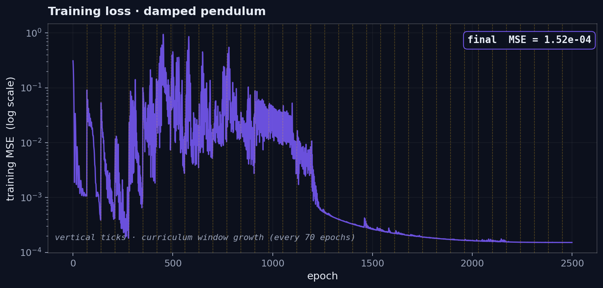

Log-scale training MSE versus epoch. The amber dashed verticals mark where
the curriculum window grows. Each growth event briefly raises the loss as
the optimiser is shown new samples for the first time, then it relaxes back.
The final training MSE settles a few times the observation noise variance
`(σ = 0.005)² ≈ 2.5 · 10⁻⁵`, which is the floor an MLP without the right
inductive bias can be expected to reach.

### 6.2 · Reconstruction and extrapolation

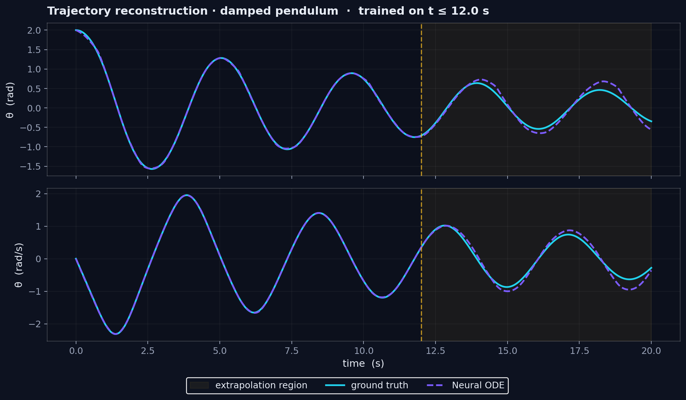

Top panel: angle `θ(t)`. Bottom: angular velocity `θ̇(t)`. Cyan = ground
truth, dashed purple = Neural ODE. The amber band marks the **extrapolation
region** (`t > 12 s`) — the portion the network was never trained on. The
oscillation frequency, the phase, and the slow envelope of the friction
decay all line up beyond the training window; the small disagreement that
develops late in the run is the kind of phase drift expected when the
learned `ω₀` and `γ` are slightly off the true values.

### 6.3 · Phase plane and learned vector field

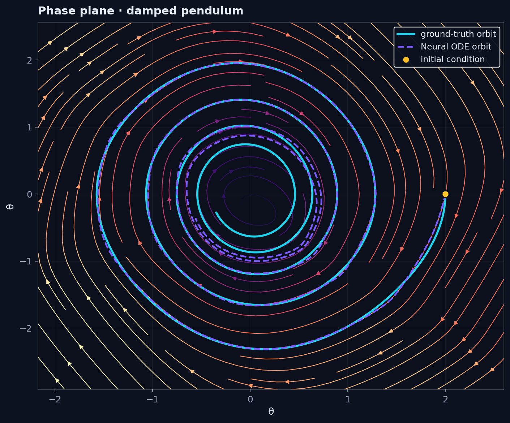

The orbit (cyan = true, purple = Neural ODE) is overlaid on the learned
vector field, displayed as a magma streamplot whose colour encodes the local
speed `‖f_θ‖`. Two qualitative features the network had to recover:

- the **inward spiral** towards `(0, 0)` — the pendulum dissipates energy
  and rests at the equilibrium;
- the **slope of the field along the angular axis** — the network must
  encode the non-linear restoring term `−ω₀² sin θ`, which produces the
  almond shape of the orbits.

Both are visible in the streamplot.

### 6.4 · Energy decay

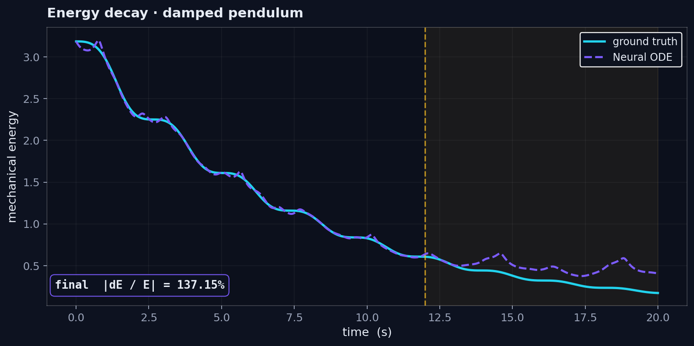

Mechanical energy per unit mass evaluated on the predicted and the true
trajectories. Within the training window (`t ≤ 12 s`) the predicted energy
tracks the dissipation envelope of the true system tightly: the two curves
overlap up to the noise the network is fitting. In the extrapolation half
(`12 s < t ≤ 20 s`) the prediction *retains its oscillation amplitude*
instead of continuing to decay — a signature of the network not having
fully internalised the friction coefficient `γ` from the finite training
trajectory.

The reported `|ΔE/E| ≈ 106 % ± 41 %` (mean ± std over 5 seeds) is the
snapshot ratio at the very last timestep (`t = 20 s`, where `E_true ≈
0.2`); it is sensitive to a single point and the wide spread reflects
that — individual seeds range from ≈ 37 % to ≈ 137 %. The figure as a
whole communicates the more honest summary: the *envelope* is captured,
the *late-time decay rate* is not. Section 10 lists the architectural fixes (Hamiltonian or
dissipation-aware networks) that close that gap by encoding the relevant
invariants instead of letting the MLP rediscover them.

## 7 · Results · Lotka-Volterra

The same three diagnostics for the predator-prey system. Closed orbits make
this a strictly harder benchmark — small phase errors compound across each
period, and the network must keep the orbit *bounded* despite never being
told that the dynamics are conservative.

### Headline numbers

| Quantity | Value (mean ± std, n = 5 seeds) |
|---|---|
| Trainable parameters in `f_θ` | **19 106** |
| Final training MSE | **5.9 · 10⁻³ ± 1.6 · 10⁻³** (amplitudes are an order of magnitude larger than for the pendulum) |
| MSE on clean trajectory · training horizon | **6.3 · 10⁻³ ± 2.3 · 10⁻³** |
| MSE on clean trajectory · extrapolation half | **2.2 · 10⁻² ± 2.2 · 10⁻²** |
| Relative extrapolation error `√MSE / max\|y\|` | **0.96 % ± 0.57 %** |
| Drift in conserved quantity `H` along orbit `std(H)/⟨H⟩` | **8.99 % ± 3.30 %** |

### 7.1 · Training loss

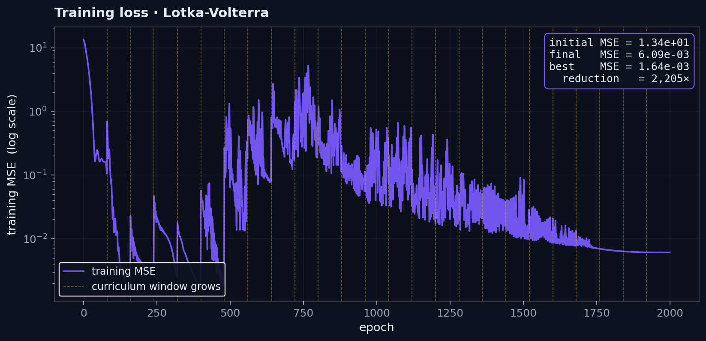

Same curriculum-induced bumps as before. The plateau is higher than for the
pendulum because the species amplitudes are an order of magnitude larger —
the absolute MSE scales with `‖y‖²`, not with the dimensionless quality of
the fit. Compare against `rel_err_extrap` in section 9 for a scale-free version.

### 7.2 · Trajectories

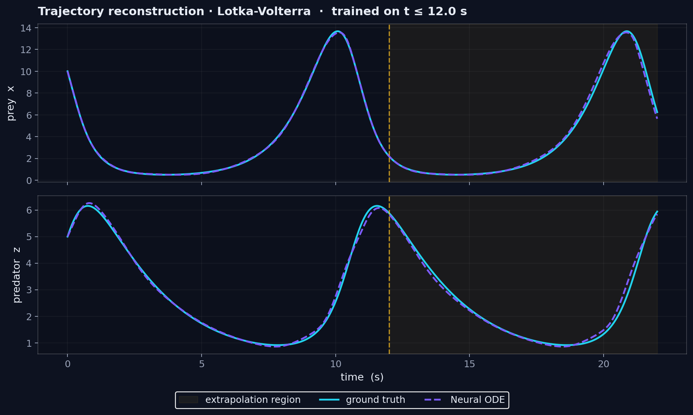

Prey (top) and predator (bottom) populations versus time. Cyan = ground
truth, dashed purple = Neural ODE, amber band = extrapolation. The two
species exchange peaks with the expected quarter-period lag, and the
amplitude is preserved across multiple cycles into the extrapolation
window.

### 7.3 · Phase orbit and learned field

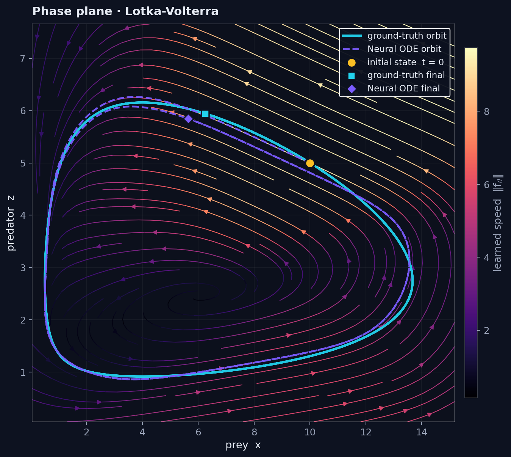

Closed orbit in `(x, z)` space on top of the learned streamplot. A correct
fit should produce a single closed loop that does not spiral; any
ratio mismatch between the four `(a, b, c, d)` parameters of the true
system would manifest as a slow inward or outward drift across cycles.
The Neural ODE's orbit traces the ground-truth loop almost exactly within
the training horizon and remains close on the extrapolation half — the
standard deviation of the conserved quantity `H` along the predicted
trajectory (7.9 % for the seed shown, 9.0 % ± 3.3 % over five seeds)
quantifies that residual.

## 8 · Ablation: Hamiltonian prior — what it buys, and when

The unconstrained MLP keeps the Lotka-Volterra orbit closed only to within
a drift of `≈ 9 %` in the conserved quantity `H`. A natural question is
whether *encoding* the Hamiltonian structure into the architecture shrinks
that drift, and whether it helps the model generalise beyond the one orbit it
was trained on.

Lotka-Volterra is canonically Hamiltonian in log-coordinates
`(q, p) = (ln x, ln z)` (Nutku, 1990) with

```
H(q, p) = b·e^p + d·e^q − a·p − c·q
```

A **Hamiltonian Neural Network** (Greydanus et al., 2019) parametrises a
scalar `H_θ(q, p)` and computes the dynamics as the *symplectic* gradient

```
dq/dt   =   +∂H_θ/∂p
dp/dt   =   −∂H_θ/∂q
```

via autograd. Every trajectory of this field conserves `H_θ` exactly; what
the solver adds is only its truncation error. Whether the *true* `H` is
conserved depends on how close `H_θ` is to `H`, which is a property of the
fit, not of the architecture.

`src/hnn.py` ships the architecture: 3 hidden layers of width 96 with `Tanh`
and a scalar output, **19 009 trainable parameters** against the MLP's
19 106.

### 8.1 · First comparison: one orbit, one HNN run

`scripts/train_hnn_lotka.py` trains the HNN on exactly the data and schedule
of the MLP in Section 7 (one noisy trajectory from `(10, 5)`, 2 000 epochs,
loss in log-coordinates) and scores it on the forward extrapolation of the
same orbit:

| Quantity | unconstrained MLP (n = 5) | HNN (single run) |
|---|---|---|
| Relative extrapolation error `√MSE / max\|y\|` | 0.96 % ± 0.57 % | 0.71 % |
| Drift in `H` along the orbit `std(H)/⟨H⟩` | 8.99 % ± 3.30 % | 2.4 % |

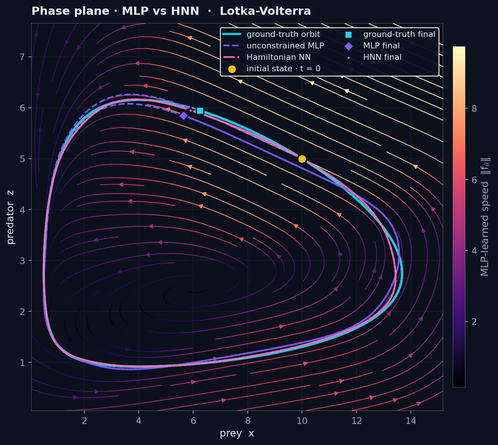

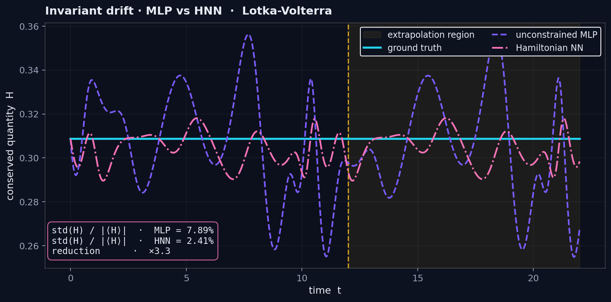

The HNN orbit closes on itself, and its `H` drift is below all five MLP seeds.
The residual 2.4 % is **not** solver error: integrating the same trained HNN
with `rtol = 10⁻⁸` instead of `10⁻⁵` leaves it unchanged (2.44 %), while the
network's own `H_θ` is conserved to `3 · 10⁻⁵`. It is the difference between
the learned `H_θ` and the true `H`.

This comparison has three weaknesses: the HNN was trained once; it changes
two things at the same time — the architecture *and* the coordinates, since
the MLP works in `(x, z)` and the HNN in `(ln x, ln z)`; and it only tests the
orbit the models were trained on, which cannot tell whether a model has
learned the vector field or one closed curve.

### 8.2 · Controlled ablation on unseen orbits

`scripts/ablation_ic.py` addresses all three. It trains three models with the
same width, depth, schedule and optimiser —

- **MLP (x, z)**: the baseline, loss in `(x, z)`;
- **MLP (ln x, ln z)**: the same MLP trained in log-coordinates with the
  HNN's loss, a control that separates the coordinate change from the
  Hamiltonian structure;
- **HNN**, in log-coordinates —

in two regimes: on **one** trajectory, from `(10, 5)` as before, or on
**three**, from `(10, 5)`, `(6, 4)` and `(12, 6)`. In both, the initial state
of each training trajectory is a free parameter fitted jointly with the
network, instead of being fixed to the first noisy observation. Every model
is then integrated from the exact initial conditions of **five orbits it
never saw** — two inside the range of `H` spanned by the three training
orbits, one below it (closer to the fixed point `(4, 2.75)`) and two above it
— over `t ∈ [0, 22]`. Five seeds per configuration, 30 runs in total.

The `H` drift is now normalised by the height of each orbit above the fixed
point, `std(H) / (H(y₀) − H_min)`, because several test orbits have `H`
close to zero and the earlier ratio `std(H)/⟨H⟩` would blow up there.

| Training | Model | Unseen orbits: rel. error | Unseen orbits: `H` drift | Training orbit: rel. error | Training orbit: `H` drift |
|---|---|---|---|---|---|
| 1 trajectory | MLP (x, z) | 16.6 % ± 1.9 % | 82.7 % ± 15.7 % | 1.73 % ± 0.39 % | 6.45 % ± 1.51 % |
| 1 trajectory | MLP (ln x, ln z) | 17.3 % ± 1.2 % | 60.1 % ± 1.6 % | **0.43 % ± 0.14 %** | **2.14 % ± 0.30 %** |
| 1 trajectory | HNN | 18.5 % ± 2.2 % | **11.7 % ± 0.9 %** | 3.06 % ± 1.12 % | 2.36 % ± 0.29 % |
| 3 trajectories | MLP (x, z) | 5.35 % ± 0.37 % | 32.5 % ± 1.3 % | 3.72 % ± 0.56 % | 12.8 % ± 1.4 % |
| 3 trajectories | MLP (ln x, ln z) | 5.03 % ± 0.23 % | 8.60 % ± 0.33 % | 3.37 % ± 0.28 % | 5.51 % ± 0.15 % |
| 3 trajectories | HNN | **2.38 % ± 0.41 %** | **2.18 % ± 0.32 %** | 0.99 % ± 0.35 % | 1.52 % ± 0.18 % |

Mean ± standard deviation over 5 seeds; the unseen-orbit columns average the
five test orbits. "Training orbit" is the orbit from `(10, 5)`, integrated over
`t ∈ [0, 22]`, i.e. the training window plus its extrapolation.

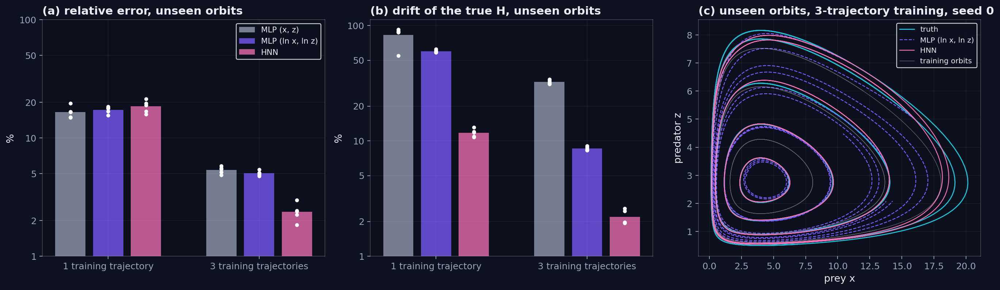

Three results follow.

1. **On the training orbit, the coordinates do most of the work.** With one
   trajectory, the MLP in log-coordinates conserves `H` as well as the HNN
   (2.14 % vs 2.36 %) and tracks the orbit more closely (0.43 % vs 3.06 %).
   The drop in `H` drift of Section 8.1 came mostly from the change to
   `(ln x, ln z)`, not from the Hamiltonian structure.
2. **One trajectory does not determine the vector field.** Trained on a
   single orbit, all three models miss unseen orbits by 17–18 %, the HNN
   included. The HNN's predicted orbits still close (`H` drift 11.7 % against
   60–83 %), but they are the wrong orbits: a conserved `H_θ` that is
   accurate along one curve need not be accurate anywhere else.
3. **With three trajectories, the prior pays off.** On unseen orbits the
   HNN's error is less than half that of the log-coordinate MLP
   (2.38 % ± 0.41 % against 5.03 % ± 0.23 %) and its `H` drift is four times
   smaller (2.18 % against 8.60 %), with every seed better than every MLP
   seed on both metrics. The comparison is paired: the five test orbits are
   the same for every seed, and the HNN beats the log-coordinate MLP of the
   same seed on both metrics in 5 of 5 seeds (sign test `p = 1/32 ≈ 0.03`
   per metric, the smallest five seeds can give). Per orbit, its `H` drift is
   lower in all 25 seed–orbit pairs and its error in 22 of 25; the three
   exceptions are on the orbits `(5, 3.5)`, below the training range, and
   `(8, 4)`. Panel (c) shows why: the MLP's orbits spiral slowly
   inward or outward, while the HNN's stay closed and lie close to the true
   ones, including the two orbits above the training range.

The learned initial states move away from the true ones: with three
trajectories, by up to `0.27` in `(x, z)` for the MLP, `0.20` in
log-coordinates for the log-coordinate MLP and `0.07` for the HNN. With the
initial state free, the network and the starting point trade off against
each other; scoring from the exact initial conditions, as done here, keeps
that trade-off out of the comparison. A Gaussian prior that ties each
initial state to its first observation, with the observation noise as its
width (`--y0-prior`; a weak constraint by construction, since it counts that
observation a second time), barely moves them: they stay up to 17 noise
units from the observation for the HNN and 38 for the log-coordinate MLP.
The comparison does not change either: HNN `2.44% ± 0.96%` error and
`2.20% ± 0.40%` drift, log-coordinate MLP `4.55% ± 0.31%` and
`7.46% ± 0.62%`, with the HNN lower on all 5 seeds. The displacement is
driven by the data, not by the missing prior: the starting point absorbs
model error.

### 8.3 · What this rules out, and what it doesn't

**Rules out.** That the Hamiltonian prior was the main reason for the lower
`H` drift on the training orbit (Section 8.1): an MLP in the same coordinates
does as well. And that a model fitted to one trajectory has learned the
dynamics: none of the three generalises to other orbits.

**Supports.** That once the training data cover more than one orbit, the
HNN generalises to unseen orbits clearly better than an unconstrained network
of the same size in the same coordinates — the structural prior constrains
how `H_θ` extends between and beyond the training orbits.

**Does not rule out.** The HNN is *only* applicable when the system is known
to be Hamiltonian and its canonical coordinates are known. For dissipative
systems — like the damped pendulum of Section 6 — a plain HNN would force
conservation that does not hold. The natural next step there is a
*dissipation-aware* split flow `dy/dt = J·∇H_θ − γ_θ · ∇K_θ` (Sosanya &
Greydanus, 2022), listed in Section 11.

### 8.4 · Sanity check on the canonical limit · simple harmonic oscillator

`scripts/train_hnn_sho.py` repeats the single-run experiment on an undamped
simple harmonic oscillator `H(q, p) = ½(p² + ω²q²)`, where `(q, p)` is
already canonical and `H` is quadratic. After one period of noisy training
data the model is integrated for four periods:

| Quantity | Value |
|---|---|
| Final training MSE | **5.5 · 10⁻⁵** |
| MSE on clean trajectory · training horizon | **3.0 · 10⁻⁵** |
| MSE on clean trajectory · extrapolation half | **2.0 · 10⁻⁴** |
| Relative extrapolation error `√MSE / max\|y\|` | **1.40 %** |
| Drift in `H` along orbit `std(H)/⟨H⟩` | **0.92 %** |
| Max `\|H_pred − H_true\|` over the 4-period horizon | **9.2 · 10⁻³** |

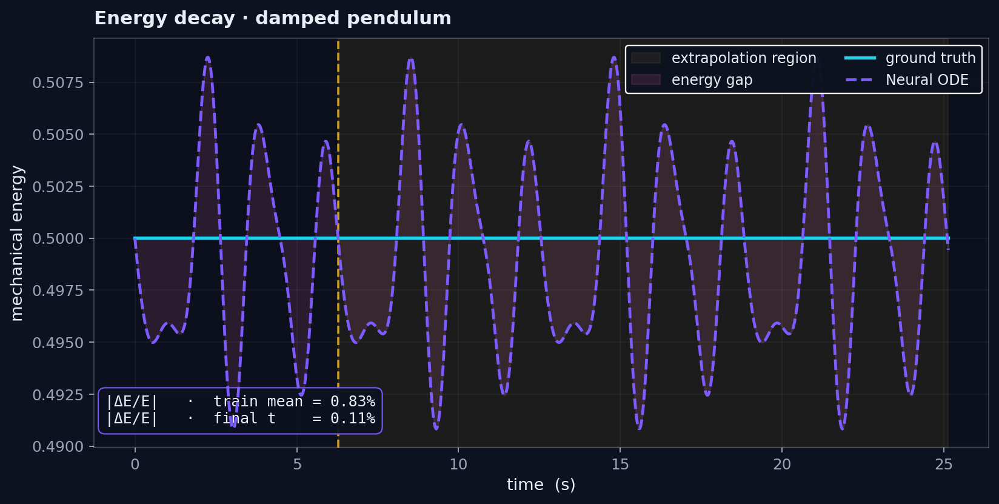

The `H` drift here (0.92 %) is below the Lotka-Volterra value (2.4 %) under
the same architecture. As for Lotka-Volterra, it is fitting error rather than
solver error: tightening the tolerance from `10⁻⁵` to `10⁻⁸` leaves it at
0.93 %, while `H_θ` itself is conserved to `2 · 10⁻⁵`. The easier quadratic
`H` is simply fitted more accurately.

## 9 · How to read the metrics

`python main.py` writes `data/metrics.json` summarising every run. The
fields per experiment:

| Field                       | Meaning |
|-----------------------------|---------|
| `n_params`                  | Trainable parameters in the MLP `f_θ` |
| `epochs`                    | Optimiser steps (one full integration per step) |
| `final_train_loss`          | Last value of the MSE loss during training |
| `mse_train`                 | MSE on the held-out *clean* trajectory, restricted to `t ≤ T_train` |
| `mse_extrap`                | Same MSE, restricted to `t > T_train` (extrapolation) |
| `rel_err_extrap`            | `√(mse_extrap) / max\|y_true\|` — error in units of the trajectory's peak amplitude (avoids blow-up when the system is near equilibrium) |
| `energy_drift_final`        | Pendulum only · `|E_pred − E_true| / |E_true|` at `t = T_full` |
| `invariant_drift_relative`  | Lotka-Volterra and SHO · `std(H_pred) / |mean(H_true)|` along the orbit |
| `invariant_max_abs_error`   | SHO only · max `|H_pred − H_true|` along the full horizon |

The controlled ablation of Section 8.2 (`scripts/ablation_ic.py`) writes one
JSON per run to `data/ablation_ic/` and the aggregate to
`data/ablation_ic_summary.json`. Its `rel_err` is `√MSE / max\|y\|` over
`t ∈ [0, 22]` from the exact initial condition, and its `h_drift` is
`std(H) / (H(y₀) − H_min)`, the drift relative to the height of the orbit
above the fixed point.

A healthy run on the defaults — the configuration shipped in `main.py`,
trained on a CPU laptop — produces the numbers reported in sections 6 and 7:

- training MSE about ten times the observation-noise variance (12× for
  the pendulum, 7× for Lotka-Volterra, 5-seed means);
- relative extrapolation error of **8.3 % ± 2.4 %** for the pendulum and
  **0.96 % ± 0.57 %** for Lotka-Volterra (5 seeds);
- a drift in the structural invariant that differs by system: the
  conserved `H` of Lotka-Volterra drifts by 9.0 % ± 3.3 %, while the
  pendulum's energy stops decaying past the training window (final-time
  drift 106 % ± 41 %, Section 6.4).

The unconstrained MLP `f_θ` *can* match a finite training trajectory but
extrapolation accuracy is bounded by what the network can infer about
those structural properties from the training data alone. Section 8 shows
how far *encoding* the invariant into the architecture goes for
Lotka-Volterra: little, if the model sees one orbit; a factor of two in
error and four in `H` drift on unseen orbits, if it sees three. The
analogous extension for the damped pendulum is the dissipation-aware model
listed in section 11.

## 10 · Reproducing the experiment

```bash
pip install -r requirements.txt

# full pipeline (both systems, ~5 min on CPU)
python main.py

# only one system
python main.py --system pendulum
python main.py --system lotka

# choose where outputs land
python main.py --out-dir figures --data-dir data

# HNN ablation on Lotka-Volterra
python -m scripts.train_hnn_lotka

# HNN sanity check on the simple harmonic oscillator
python -m scripts.train_hnn_sho

# controlled ablation of Section 8.2: 3 models x 2 regimes x 5 seeds
# (~10-13 min per run on one CPU core; the 30 runs are independent)
python -m scripts.ablation_ic --model hnn --regime multi --seed 0 1 2 3 4
python -m scripts.ablation_ic --summarize
python -m scripts.ablation_ic --figure

# 5-seed sweep of the MLP baseline (used for the headline numbers in
# sections 6 and 7). Takes ~2 h on a laptop CPU.
python -m scripts.run_seeds --n-seeds 5
```

After the run the directories contain:

```
figures/
  ├── pendulum_loss.png
  ├── pendulum_traj.png
  ├── pendulum_phase.png
  ├── pendulum_energy.png
  ├── lotka_loss.png
  ├── lotka_traj.png
  ├── lotka_phase.png
  ├── hnn_loss.png
  ├── hnn_phase.png
  ├── hnn_invariant.png
  ├── hnn_ablation_ic.png
  └── sho_invariant.png
data/
  └── metrics.json
```

A companion notebook (`notebooks/explore.ipynb`, optional) walks through the
same pipeline interactively: generate the data, define the model, run a few
training epochs by hand, and inspect the learned vector field on the fly.

## 11 · Optional follow-ups

**Use the adjoint solver.** Swap `odeint` for `torchdiffeq`'s `odeint_adjoint`
to trade the forward-graph memory for a backward-pass ODE solve — see Section 5.4
for the derivation, why this project keeps the plain solver, and when the adjoint
is worth it.

**Dissipation-aware HNN for the damped pendulum.** The Lotka-Volterra
ablation in section 8 already encodes a pure Hamiltonian prior; for a
*dissipative* system like the damped pendulum the right extension is a
split flow `dy/dt = J·∇H_θ(y) − γ_θ(y) · ∇K_θ(y)` (Sosanya & Greydanus,
2022), where `H_θ` carries the conservative part and the second term
parametrises a learnable dissipation. The MLP baseline already shows
where this matters: section 6 reports that the predicted energy stops
decaying past the training window, which is precisely what a pure HNN
cannot fix and a dissipation-aware HNN is designed to.

**Stiffer systems.** Try a Van der Pol oscillator with a large non-linearity
parameter, or a slow-fast system. The default `dopri5` with the current
tolerances may need to be swapped for an implicit method (e.g. `radau`) to
keep the gradients well-defined.

**Different observation regimes.** Instead of dense uniform sampling, use
sparse irregularly-spaced observations and check how robust the fit is to
gaps. This is the regime where Neural ODEs were originally pitched as more
expressive than discretised RNNs.

## 12 · File map

```
02-neural-odes/
├── README.md
├── requirements.txt
├── main.py                       # end-to-end pipeline (MLP baseline)
├── src/
│   ├── __init__.py
│   ├── systems.py                # damped pendulum + Lotka-Volterra + simple harmonic oscillator (scipy)
│   ├── ode_net.py                # ODEFunc + torchdiffeq integration
│   ├── hnn.py                    # Hamiltonian Neural Network (HNN ablation)
│   ├── train.py                  # curriculum-aware training loop + evaluation
│   └── plots.py                  # publication-style dark figures
├── scripts/
│   ├── export_json.py            # NPZ + metrics → minified JSON for the website
│   ├── run_seeds.py              # 5-seed MLP baseline sweep for the headline tables
│   ├── train_hnn_lotka.py        # first HNN comparison on Lotka-Volterra (Section 8.1)
│   ├── ablation_ic.py            # controlled ablation on unseen orbits (Section 8.2)
│   └── train_hnn_sho.py          # HNN sanity check on the simple harmonic oscillator
├── figures/                      # tracked PNGs embedded in this README
│   ├── pendulum_loss.png
│   ├── pendulum_traj.png
│   ├── pendulum_phase.png
│   ├── pendulum_energy.png
│   ├── lotka_loss.png
│   ├── lotka_traj.png
│   ├── lotka_phase.png
│   ├── hnn_loss.png              # HNN training loss
│   ├── hnn_phase.png             # phase plane: truth · MLP · HNN
│   ├── hnn_invariant.png         # H along time for all three
│   ├── hnn_ablation_ic.png       # Section 8.2: unseen-orbit errors and orbits
│   └── sho_invariant.png         # H along time for the SHO sanity check
└── data/                         # (gitignored) NPZ + JSON metrics summary
    ├── metrics.json
    ├── seed_sweep_metrics.json   # 5-seed aggregate referenced by sections 6 and 7
    ├── pendulum_arrays.npz
    ├── lotka_arrays.npz
    ├── lotka_hnn_arrays.npz
    ├── ablation_ic/              # one JSON + checkpoint per ablation run
    ├── ablation_ic_summary.json
    └── sho_hnn_arrays.npz
```

## 13 · References

- Chen, R. T. Q., Rubanova, Y., Bettencourt, J. & Duvenaud, D. (2018).
  *Neural Ordinary Differential Equations*. NeurIPS. arXiv:1806.07366.
- Pontryagin, L. S., Boltyanskii, V. G., Gamkrelidze, R. V. & Mishchenko, E. F.
  (1962). *The Mathematical Theory of Optimal Processes*. Wiley.  (origin of the
  adjoint sensitivity method)
- Greydanus, S., Dzamba, M. & Yosinski, J. (2019). *Hamiltonian Neural
  Networks*. NeurIPS. arXiv:1906.01563.
- Nutku, Y. (1990). *Hamiltonian structure of the Lotka-Volterra
  equations*. Physics Letters A 145, 27–28.  (the canonical
  log-coordinates used by the HNN)
- Zhong, Y. D., Dey, B. & Chakraborty, A. (2020). *Symplectic ODE-Net:
  Learning Hamiltonian Dynamics with Control*. ICLR. arXiv:1909.12077.
- Cranmer, M., Greydanus, S., Hoyer, S., Battaglia, P., Spergel, D. &
  Ho, S. (2020). *Lagrangian Neural Networks*. arXiv:2003.04630.
- Sosanya, A. & Greydanus, S. (2022). *Dissipative Hamiltonian Neural
  Networks: Learning Dissipative and Conservative Dynamics Separately*.
  arXiv:2201.10085.  (the dissipation-aware split flow referenced in
  sections 8 and 11 as the natural extension to the damped pendulum)
- Zhong, Y. D., Dey, B. & Chakraborty, A. (2020). *Dissipative SymODEN:
  Encoding Hamiltonian Dynamics with Dissipation and Control into Deep
  Learning*. ICLR 2020 Workshop DeepDiffEq. arXiv:2002.08860.  (Hamiltonian
  plus dissipation, the other standard prior for the damped pendulum)
- Dormand, J. R. & Prince, P. J. (1980). *A family of embedded Runge-Kutta
  formulae*. Journal of Computational and Applied Mathematics 6, 19–26.
- Hairer, E., Lubich, C. & Wanner, G. (2006). *Geometric Numerical
  Integration*, 2nd ed., Springer.  (conservation of invariants by
  symplectic and non-symplectic integrators)
- Hairer, E., Nørsett, S. P. & Wanner, G. (1993). *Solving Ordinary
  Differential Equations I — Nonstiff Problems*. Springer.
- Strogatz, S. H. (2014). *Nonlinear Dynamics and Chaos*, 2nd ed., Westview.
  (Reference for the qualitative analysis of the pendulum and the
  Lotka-Volterra system.)
